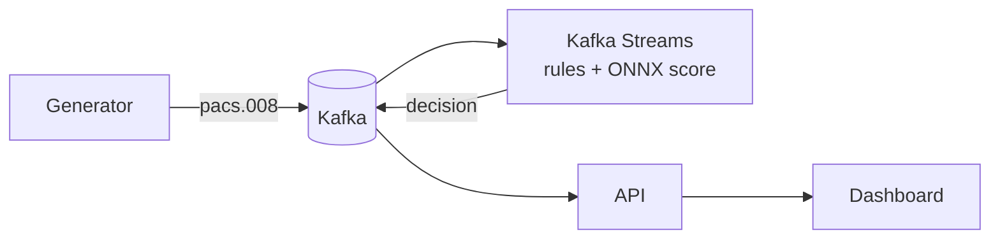

# InstantGuard

[](https://github.com/tarikiguezarane/instantguard/actions/workflows/ci.yml)
[](LICENSE)

**Real-time fraud detection for SEPA Instant credit transfers and Wero payments**:
ISO 20022 pacs.008 messages streamed through Kafka Streams, fraud rules combined with an
Isolation Forest score, an ACCEPT / REVIEW / REJECT decision in well under 10 seconds,
end-to-end OpenTelemetry tracing and an analyst dashboard.

> Status: work in progress, built step by step following [ROADMAP.md](ROADMAP.md)
> (progress log in [JOURNAL.md](JOURNAL.md), both in French).
> **Synthetic data only**: test IBANs, no real customer or transaction data.

## Context

- **SEPA Instant Credit Transfer (SCT Inst)** moves euros between European accounts in at most
  **10 seconds**, 24/7. The EU Instant Payments Regulation (2024/886) makes it mandatory for
  euro-area payment service providers and requires instant transfers to cost no more than
  standard ones, so volumes are growing fast.
- **Wero** is the European wallet launched by the European Payments Initiative; it relies on
  SEPA Instant rails for account-to-account payments.
- An instant transfer is **irrevocable**: once the payee is credited, the money is gone.
  Fraud (account takeover, authorised push payment scams, mule accounts) must therefore be
  stopped *before* execution, inside the 10-second budget, with no batch post-processing.

## How it works (target)



1. A Python generator produces realistic synthetic transfers with labelled fraud patterns.
2. Kafka Streams normalises each pacs.008 and evaluates rules: velocity per debtor, new payee
   combined with amount, abnormal amount (rolling z-score).
3. An Isolation Forest model trained on the synthetic data (exported to ONNX) adds an anomaly score.
4. The decision engine returns ACCEPT, REVIEW or REJECT with a pacs.002-like status and reasons.
5. Alerts reach the analyst dashboard; every step is traced with OpenTelemetry.

Details, topics and latency budget in [docs/architecture.md](docs/architecture.md).

## Repository layout

```
generator/   Python synthetic pacs.008 generator
streams/     Kafka Streams application (Java 21, Maven)
ml/          Feature extraction, Isolation Forest training, ONNX export
api/         Spring Boot API
dashboard/   Angular dashboard
infra/       Docker Compose: Kafka KRaft, observability stack
docs/        Architecture notes
scripts/     Helper and check scripts
```

## Stack

Java 21 · Kafka Streams · Python · scikit-learn · ONNX Runtime · Spring Boot · Angular ·
OpenTelemetry · Prometheus · Grafana · Jaeger / Tempo · Docker Compose · GitHub Actions

## License

[MIT](LICENSE) © 2026 Tarik Iguezarane
