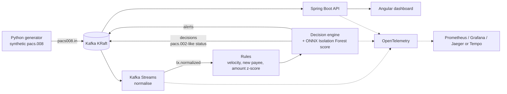

# Target architecture

## Kafka topics

| Topic | Content |
|-------|---------|
| `pacs008.in` | Raw ISO 20022 pacs.008 XML messages |
| `tx.normalized` | Validated, normalised transfers (JSON) |
| `decisions` | ACCEPT / REVIEW / REJECT with reasons and score |
| `alerts` | Transfers needing analyst attention |

## Latency budget

SEPA Instant gives the whole chain **10 seconds** to credit the payee. The fraud decision must
therefore take a small, bounded slice of that budget; the target is well under one second at
the 99th percentile, measured end to end with OpenTelemetry.
